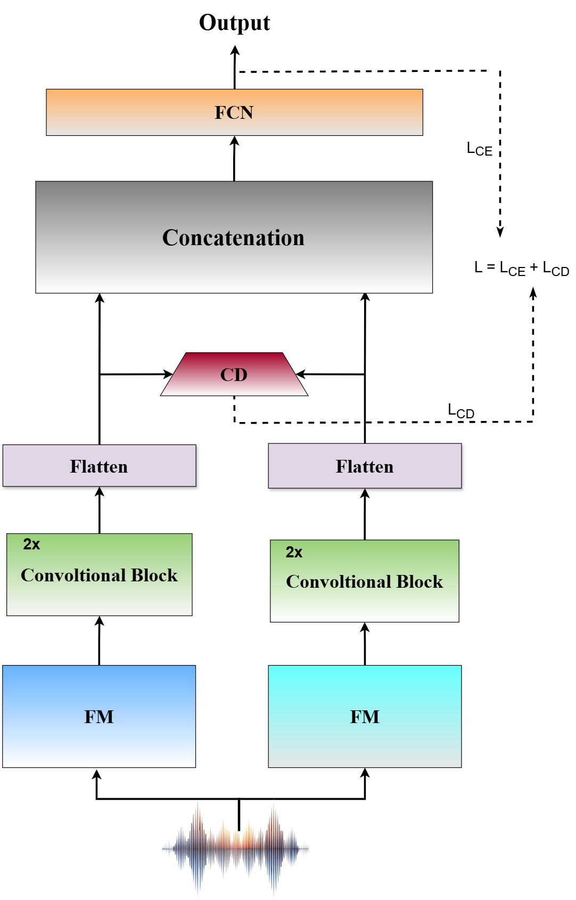

<div align="center">

# COFFE (Fusion using ChernOFF DistancE)
## Towards Source Attribution of Singing Voice Deepfake with Multimodal Foundation Models
[](https://arxiv.org/pdf/2506.03364), [INTERSPEECH 2025]

</div>

---

**Abstract**  
In this work, we introduce the task of singing voice deep
fake source attribution (SVDSA). We hypothesize that multi
modal foundation models (MMFMs) such as ImageBind, Lan
guageBind will be most effective for SVDSA as they are bet
ter equipped for capturing subtle source-specific characteris
tics—such as unique timbre, pitch manipulation, or synthesis
 artifacts of each singing voice deepfake source due to their cross
modality pre-training. Our experiments with MMFMs, speech
 foundation models and music foundation models verify the hy
pothesis that MMFMs are the most effective for SVDSA. Fur
thermore, inspired from related research, we also explore fusion
 of foundation models (FMs) for improved SVDSA. To this end,
 we propose a novel framework, COFFE which employs Cher
noff Distance as novel loss function for effective fusion of FMs.
 Through COFFE with the symphony of MMFMs, we attain the
 topmost performance in comparison to all the individual FMs
 and baseline fusion methods.
 Index Terms: Source Attribution, Singing Voice Deepfake,
 Deepfake Detection

---
## Source code to be released soon—stay tuned.
---

<div align="center">
    
</div>

---
## Citation
If you find this work useful, please consider citing us:

```bibtex

@misc{phukan2025sourceattributionsingingvoice,
    title={Towards Source Attribution of Singing Voice Deepfake with Multimodal Foundation Models}, 
    author={Orchid Chetia Phukan and Girish and Mohd Mujtaba Akhtar and Swarup Ranjan Behera and Priyabrata Mallick and Pailla Balakrishna Reddy and Arun Balaji Buduru and Rajesh Sharma},
    year={2025},
    eprint={2506.03364},
    archivePrefix={arXiv},
    primaryClass={eess.AS},
    url={https://arxiv.org/abs/2506.03364}, 
}